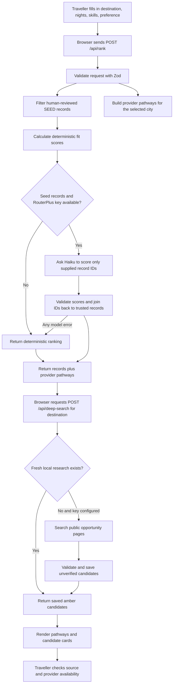

# StayZero: How the app works

This document describes the implementation in this repository. It is a practical guide for someone running, extending, or demoing the app. For the build sequence and acceptance checklist, see [BUILD_SPEC.md](BUILD_SPEC.md). For research on how platforms source stays and the current sourcing decision, see [ACCESS_RESEARCH.md](ACCESS_RESEARCH.md).

## 1. Product and the important distinction

StayZero helps a traveller find ways to stay without paying a nightly room rate. It accepts any destination as text (for example, “Mysuru, India” or “Lisbon, Portugal”); Bangalore and Hyderabad are autocomplete suggestions. It asks for destination, nights, skills offered, and stay preference, then presents relevant routes and possible fees and exchange requirements.

There are two different kinds of results:

1. **Provider pathways** are directory cards with links to another service's website. They explain how to search there and what kind of exchange to expect. StayZero does not download that service's host profiles, calendars, or live availability.
2. **Curated opportunities** are individual records manually entered in `src/lib/seed.ts` after a person checks the source page and records what it says. The seed is currently empty, so there are no human-verified individual stay cards yet.
3. **Research candidates** are public program or opportunity pages. Six source-linked candidates for Bengaluru and Hyderabad ship with the app in `src/lib/research-baseline.ts`; RouterPlus can find additional pages for any typed destination. All candidates are amber and unverified until a person checks the source.

This distinction is central to the product's trust claim: ranking can order known records, but it cannot create a real place, host, price, or availability.

## 2. Request flow



The browser form lives in `src/app/page.tsx`. Its defaults are Bangalore, India; five nights; no skills; and any category. Destination is free text with 90+ popular city suggestions spanning India and other countries; any other place can be typed too. Submitting sends JSON to `/api/rank` and then automatically requests saved or new web research for that destination. If the user submits again, previous results are cleared first.

The ranking route validates the request and performs filtering in application code. Provider pathways are produced independently of the AI call, so they still appear when the seed is empty or the AI service is unavailable. With the current empty seed, the API returns zero curated records and the eligible provider pathways.

## 3. Provider pathways: where they come from

`src/lib/provider-adapters.ts` contains one small adapter per source. Each creates a typed `ProviderGateway` for the destination and the traveller's skills. These are descriptions and outbound links, not provider API responses. Bangalore and Hyderabad use known city pages when available. Other destinations link to the provider's general site with instructions to search for the entered place. The Vipassana gateway only appears for its known Bangalore/Hyderabad centres and for stays of at least ten nights.

The current adapters cover:

- Dhamma Paphulla or Dhamma Khetta: a structured residential Vipassana course, considered only for trips of at least ten nights.
- BeWelcome and Trustroots: hospitality exchange communities where travellers search and contact hosts themselves.
- Couchsurfing: a hospitality community whose current access cost should be checked on its site.
- Worldpackers and Volunteer Yatra: work or skill exchange routes; duties, dates, fees, meals, and accommodation depend on the individual project.
- HomeExchange: a home or GuestPoints exchange route.

The adapter filter limits results by category and trip length. It orders volunteer exchanges higher when skills were offered, or hospitality exchange higher when the traveller selected “Nothing”; known city pages also get a small ordering preference. This is a suggestion for where to start, not a claim that a host is available or likely to accept.

Each provider card is rendered by `src/components/ProviderGatewayCard.tsx`. It shows the category, whether the link is a city page or requires searching on the provider, known access-cost caveats, the type of exchange, relevance to the traveller, instructions, and an external source link. Links open the original provider in a new tab. The traveller then searches, checks live terms, and applies with that provider.

**So how does StayZero pull the stays?** At present, it does not pull individual stay listings. It pulls together the documented routes to find them and sends the traveller to the source. Live listings would require an authorized API or partner feed, or hosts submitting opportunities directly to StayZero with permission to publish. Do not scrape private member profiles or imply live inventory without permission and a real data source. More background is in [ACCESS_RESEARCH.md](ACCESS_RESEARCH.md).

## 4. Curated opportunity data and verification

`src/lib/seed.ts` defines the shared Zod schemas, TypeScript types, categories, cities, skill choices, and curated record array.

An `Opportunity` contains:

- Stable slug ID, name, city, optional area, category, and whether it is a place or a platform gateway.
- Description and cost: the nightly price is constrained to literal `0`; required membership, donation, or other costs go in `mandatoryExtras`, with amount and whether it is per night, stay, or year. Donations can be marked expected and notes can explain uncertain details.
- Stay limits: typical maximum nights and/or minimum commitment nights.
- Requirements: requested skills, hours per day, ID and references, and written rules.
- Evidence: source URL/name, the actual retrieval date, a human-verification marker, and a note describing what the reviewer checked.
- Safety signals and instructions for how to secure the stay.

An entry only gets the curated badge through the `Opportunity` path, and the `evidence.verification` field must be `curated-human`. `validateSeed()` checks each record, duplicate IDs, placeholder URLs/notes, and the minimum target of 12 records (at least eight Bangalore and four Hyderabad). The seed currently contains `[]`; `SEED_REVIEW.md` is a candidate review queue, not verified inventory. A person must open each source and check its current terms before entering an opportunity. Never set a verification date or note based on a model guess.

`src/components/OpportunityCard.tsx` renders curated records with their source-check date, ₹0 nightly price plus extra costs, fit score and reasons, requirements, stay limits, safety notes, and original evidence link. If a trip is longer than a record's typical maximum, the API keeps the record and marks it as partial coverage. Records with a minimum commitment longer than the requested trip are filtered out.

## 5. Deterministic ranking

`src/lib/rank.ts` exports a pure `heuristicRank(listings, offers)` function. It starts each record at 50 points and uses only the saved record fields and skills the traveller selected:

- With no offered skills and no skills required by the listing: add 20.
- With offered skills that overlap listing requirements: add 10 per match, up to 30.
- If the traveller offered skills but none overlap requirements: subtract 15.
- If the record is a direct place rather than a platform gateway: add 10.
- If the record has no mandatory extra cost: add 5.
- Clamp the result to 0–100, produce up to three plain-language reasons, and sort by score descending with ID as a stable tie-breaker.

The score describes fit to the selected preferences. It is not an estimate of host acceptance, safety, or availability. This path requires no API key and is the guaranteed fallback.

## 6. Optional AI ranking

`src/app/api/rank/route.ts` calls the ranking function first, then may ask RouterPlus to improve the ordering if there are filtered curated records and a key is configured. The model ID is `claude-haiku-5-5`; the RouterPlus base URL defaults to `https://api.routerplus.com`.

The model receives only a minimal description of each already-filtered seed record and the traveller's inputs. It must return a `score_listings` tool result with IDs, numeric fit, and up to three reasons. The server validates the tool data, ignores IDs not in the filtered seed, discards duplicate IDs, clamps scores to 0–100, and joins each accepted ID back to its original seed object. That means displayed listing names, costs, requirements, safety text, and URLs always come from the source-reviewed seed, not generated text. If the request times out (eight seconds), fails validation, hits a quota, or raises any API error, the server returns the deterministic ranking instead.

Because the seed is empty today, the API intentionally skips the AI ranking call even if a key is present. There is nothing real for it to score.

## 7. Optional live web search

`src/app/api/deep-search/route.ts` accepts a free-text destination. When enabled and configured, it asks `claude-sonnet-5-5` to use the RouterPlus `web_search_20250305` server tool and find public opportunity pages for that destination. It requires source URLs, validates candidates with `liveResultSchema`, forces the destination and unverified status on the server, removes invalid or duplicate candidates, excludes seed source hosts, and caps each research run at six results.

These results use the separate `LiveResult` type with `verification: "live-unverified"` and render through `src/components/LiveResultCard.tsx` with an amber warning. A model finding a URL is not a human verification of its current price, terms, or availability. Review every result at its source before relying on it.

`src/lib/research-baseline.ts` contains six public source candidates checked on 2026-10-11: two around Bengaluru and four for Hyderabad (one is about 180 km away). They are bundled with the app, so they appear without an API key and on Netlify. `src/lib/research-store.ts` saves additional agent findings in an ignored local JSON file during development, or persistent Netlify Blobs when `STAYZERO_STORAGE=netlify-blobs` (or Netlify runtime variables) are present. Results are deduplicated by normalized destination, source URL, and name. Results less than 24 hours old are reused; “Search for more sources” can force another web search and new records are merged. Each store is capped at 5,000 records. Netlify Blobs keeps data across function restarts and deploys; concurrent writes to the same destination use last-write-wins semantics.

The rank response sets `deepSearchEnabled` only when a key exists and `DEEP_SEARCH` is not `off`; this controls whether the refresh button appears. Saved research can still be returned if the key is missing or search is disabled. If no saved results exist, the page explains that AI research needs a configured key. When a research call fails, older results are returned when available. The RouterPlus key used earlier had exceeded its monthly cap; recheck the key before expecting AI searches to complete.

## 8. Frontend and dark mode

The UI is a Next.js client page. `src/app/layout.tsx` supplies document metadata and imports `src/app/globals.css`. The search form supports any typed destination, one to 365 nights, five skill options, and four categories. Result sections distinguish curated records, source directories, and unverified web results. A footer reminds users to confirm acceptance, availability, and current rules with the source.

The header theme control switches between light and dark palettes. On first load, the page reads `stayzero-theme` from browser local storage; if there is no saved choice, it uses the operating system's `prefers-color-scheme` setting. The toggle updates the root `data-theme` attribute and saves the choice locally. Theme styles in `globals.css` cover the page background, text, fields, cards, status badges, buttons, and links. The preference stays in that browser only; it is not tied to an account.

## 9. API reference

### `POST /api/rank`

Request JSON:

```json
{
  "city": "bangalore",
  "nights": 5,
  "offers": ["web-development"],
  "preference": "any"
}
```

`city` is a destination string from 2 to 100 characters; include region/country when needed to disambiguate it. `nights` is an integer from 1 to 365; `offers` is an array of configured skill keys; `preference` is `any` or one of the four category keys. Curated records match by normalized destination; provider routes can show for any destination.

Response shape:

```json
{
  "ranked": "heuristic",
  "results": [],
  "gateways": [],
  "deepSearchEnabled": false
}
```

Each `results` entry contains the full trusted `opportunity`, `fit`, `reasons`, and `staysCapped`. Gateways contain source pathways, not actual host records.

### `POST /api/deep-search`

Request JSON: `{ "city": "Lisbon, Portugal", "refresh": false }`. It returns destination-matched saved results if they are less than 24 hours old. Otherwise it searches when enabled and a key is configured. Set `refresh: true` to force new research. The response contains `results`, an `at` timestamp, and a `saved` flag. Candidates always remain unverified.

### `GET /api/health`

Returns `seedErrors` from `validateSeed()`. With no RouterPlus key it reports both AI probes as skipped. With a key it tries one Haiku message and one Sonnet web-search message and reports each success/error in JSON. This is a smoke check, not a guarantee that future requests or current inventory will work.

## 10. Run and configure locally

Requirements: Node/npm compatible with the project's Next.js dependencies.

```powershell
cd D:\vibesprint\stayzero
npm install
npm run dev
```

Open `http://localhost:3000`. Provider pathways and heuristic ranking need no key. To enable automatic destination research and optional AI ranking, create `.env.local` in the project root:

```text
ROUTERPLUS_API_KEY=<your RouterPlus key>
ROUTERPLUS_BASE_URL=https://api.routerplus.com
```

Keep `.env.local` out of source control; never put a key in code, docs, or a commit. The current checkout has no `.env.local`. Netlify setup is in `README.md`; set `STAYZERO_STORAGE=netlify-blobs` in the site's environment variables and add the RouterPlus key there for AI research.

Useful commands:

```powershell
npm run dev
npm run lint
npm run build
npm run start
```

After build, `/api/health` can confirm seed validation and report whether configured model probes work. Next.js 16 has Cache Components enabled; a GET handler that must run at request time should call `connection()` from `next/server` before reading request-specific state. Do not add `force-dynamic` here because that conflicts with this project's Next 16 Cache Components setup. POST handlers used here do not need that workaround.

## 11. Current status and next work

- Search UI, responsive layout, arbitrary destination input, provider gateway cards, dark mode, data types, Zod validation, deterministic ranking, AI rank route, local research JSON store, deep-search route, and health route are implemented.
- The seed array is empty by design until human source review is complete. The current directory pathways are not live inventory and do not guarantee an available host.
- `.env.local` is absent, so new AI research and AI ranking are not configured in this checkout. The deterministic provider pathway search is available, and previously saved results can be shown without a key.
- The current provider links do not constitute platform API access or permission to copy listings. For actual StayZero inventory, pursue provider authorization, a partner feed, or first-party host submissions with explicit publication consent.
- Next planned product work is to move hosted research storage to a database and human-review AI discoveries before promoting any to curated opportunities. The manual seed target remains at least 12 records (minimum eight Bangalore and four Hyderabad); then review source links and the acceptance checklist in `BUILD_SPEC.md`.
- Deployment is not part of local development. Review `BUILD_SPEC.md` and explicitly authorize any deployment before publishing.
